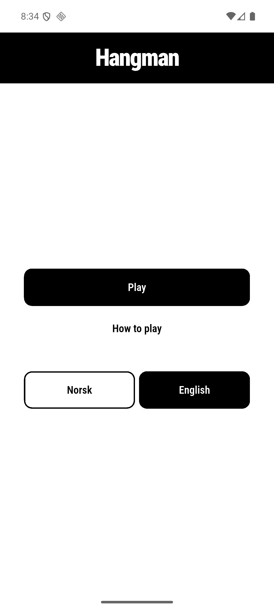
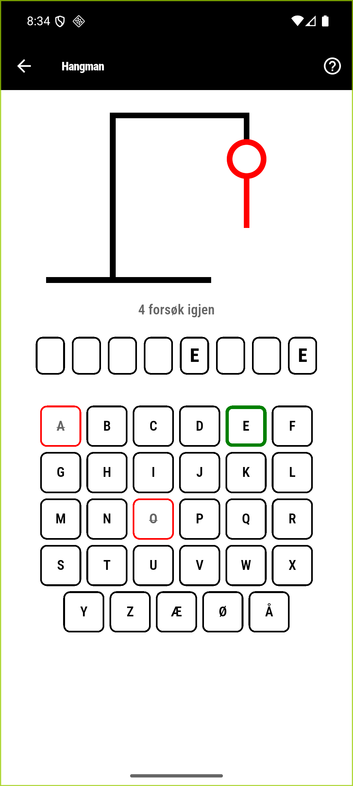
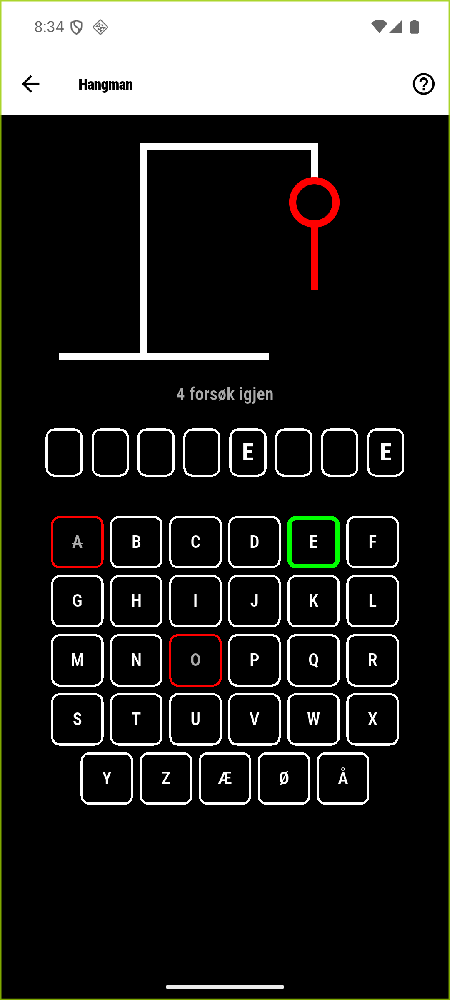
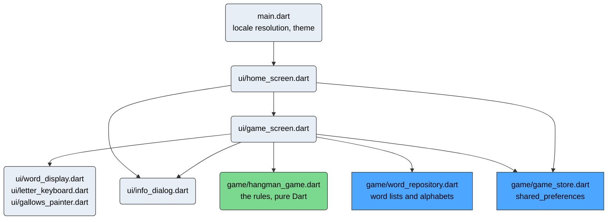
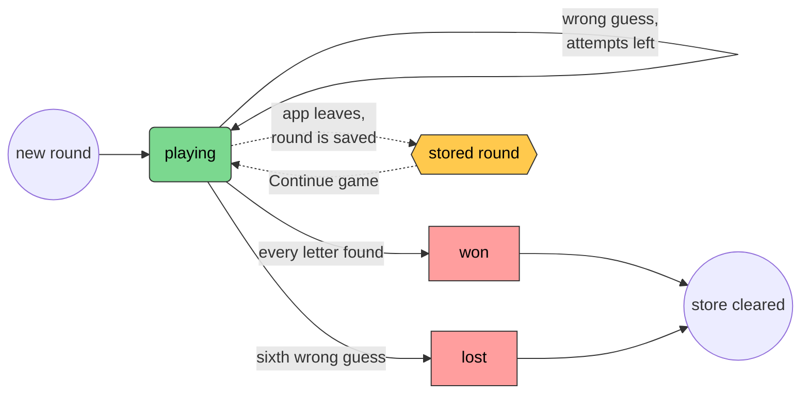
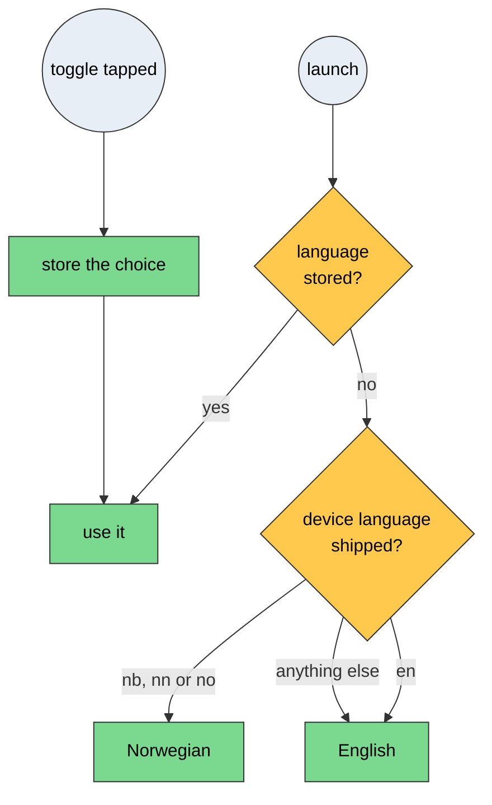

# Hangman

Hangman for the IDATT2506 project exercise at NTNU, autumn 2026. Written by Tri Le, on my own, the
way the assignment asks. Flutter and Dart, working in Norwegian and English, with the rules one tap
away from both the start screen and a running game, opening over the round rather than
replacing it, and a gallows the app draws itself instead of
assembling out of images.

Black on white, with exactly two colours that each mean one thing: green for a letter that was in
the word, red for one that was not. It follows the device into dark, where it inverts to white on
true black.

Built with Flutter 3.47.7 stable and Dart 3.13.5. Developed and tested on a Pixel 6 emulator
running **Android 16, API level 36**, which is the version the assignment asks to be stated.
`minSdk` is 24 and `targetSdk` is 36, both pinned in `android/app/build.gradle.kts` rather than
taken from whatever SDK is installed. A release APK with every ABI in it is 46.6 MB, and 16.6 MB
built for one: `flutter build apk --release --target-platform android-arm64`. That is Flutter
bringing its own renderer along. The project also carries the iOS and web targets Flutter
generates, and the web build compiles, but Android is the only one I have run on a device.

| Start screen, English                    | Mid round, Norwegian                    | The same board in dark                 |
| ---------------------------------------- | --------------------------------------- | -------------------------------------- |
|  |  |  |

Screenshots off the Pixel 6 emulator, not mockups. A key with a heavy green border was in the
word, a red one with the letter struck through was not, so the state survives being printed in
grey or read by someone who cannot separate the two colours.

## Running it on an emulator

You need the Flutter SDK on the stable channel, 3.47.7 or newer, and `flutter doctor` reporting
the Android toolchain as working.

Start an emulator with a recent system image. API 24 or newer will run it; API 36 is what it was
tested on. Android Studio does it from Device Manager, or from a terminal:

```
emulator -avd <your_avd_name>
```

Then, from the project root:

```
flutter pub get
flutter run
```

`flutter run` generates the localisation classes from the ARB files on its way, so there is no
separate code generation step to remember. A fresh clone has no `android/local.properties`, which
`flutter pub get` writes for you; running Gradle directly before that will fail.

If you would rather install an APK:

```
flutter build apk --debug
adb install -r build/app/outputs/flutter-apk/app-debug.apk
```

A release build works too, `flutter build apk --release`, and is signed with the debug key on
purpose: this is handed in and run on an emulator, not published, so a release keystore would be a
secret nobody else could reproduce.

## Seeing both languages

The app starts in whatever language the device is set to and falls back to English for anything
else. The toggle on the start screen overrides that with Norwegian or English, and switching
takes effect straight away, including mid-round: the round restarts in the new language's word
list rather than leaving you with a word you cannot spell on the keyboard in front of you.

To check that the device language is really being followed, change it in the emulator under
Settings, System, Languages, clear the app's data so no language is stored, and start it again. On
Android 13 and newer the app also appears in Settings, System, Languages, App languages, because it
ships a `locales_config.xml`.

The language reaches further than the labels. The keyboard is built from the alphabet of the active
language, so Norwegian gives you 29 keys ending in æ, ø and å while English gives you 26, and the
two word lists are separate files of about 150 words each.

Your choice sticks. Pick Norsk, close the app, open it again, and it is still Norsk.

## What is kept between launches

Two things, both through `shared_preferences` behind `lib/game/game_store.dart`: the language you
picked, and the round you were in the middle of. Leave a game half way, or let Android kill the app
in the background, and the start screen offers to continue it with the same word and the same
guesses. A finished round is dropped, so Play always gives you a fresh word, never the one you just
had. Starting a new game while a round is waiting asks first, because it throws that round away.

The stored round carries a schema version, and anything this build cannot read is thrown away
rather than resumed. The start screen reads that round while it builds, so a payload it could not
parse used to crash the app on every launch, with nothing the player could do about it.

## Playing with a keyboard

On an emulator most people type. Letters from a hardware keyboard count as guesses, æ, ø and å
included when the app is in Norwegian. Anything that is not a letter in the current alphabet, or a
letter already used, is ignored.

## Architecture



Green is the one file with no Flutter in it, blue is the two that cross into the platform (the
asset bundle and `shared_preferences`), grey is everything that draws. Rectangles touch something
outside the app, rounded nodes are plain Dart.

A round moves through three states, and which one it is in decides both what the screen shows and
whether the round is worth saving:



Amber is the only state that survives the app closing. A finished round is dropped rather than
stored, which is why Play always deals a fresh word and Continue game only appears mid-round.

Picking the language runs once at startup and again whenever the toggle is used:



Android reports Norwegian as `nb`, `nn` or `no` depending on the device, which is why all three
map to the same list. Anything the app does not ship falls back to English rather than failing.

`lib/game/hangman_game.dart` is pure Dart with no Flutter imports at all, so the rules run under
test without a device. The other two files in `lib/game/` do touch the framework:
`word_repository.dart` reads the asset bundle and `game_store.dart` talks to the
`shared_preferences` plugin. Both take their dependency as a constructor argument, which is how the
widget tests hand the game screen a fixed word and an in-memory store.

State is plain `setState` inside `_GameScreenState`, with the store and the word repository passed
in from above. No state management package. For one screen with one round in it, a `ChangeNotifier`
or a provider would add a layer without removing one; the round is already a plain object that the
screen owns and the store serialises.

## A few choices

Why Flutter and not Ionic, Cordova, React Native or Kirigami is the whole of
[docs/technology-choice.md](docs/technology-choice.md), what it cost me included.

The type is the platform condensed face, Roboto Condensed on Android, because plain Roboto is what
every Flutter app opens with.

The palette is typed out by hand, and it is four colours: black, white, green, red. A seeded
`ColorScheme` is one line and I would have got a perfectly nice purple app out of it, but then the
contrast is whatever the generator decided and I would be claiming an accessibility number I had
not checked. Red on white is only 4:1, which is fine for a border or a heading and not fine for
body text, so red never sets a sentence. The test checks the pairs rather than trusting me.

The alphabet lives in `WordRepository.alphabets`, not in the ARB files, which looks wrong at first
since it is nothing but letters. The catch is that it also drives the hardware-key filter. Keep it
with the translations and someone editing Norwegian text can quietly break typing.

The gallows is a `CustomPainter` drawing straight lines at the same weight as the borders around
it, so it belongs to the same system as the rest of the screen. The frame is black and the figure
is red, because every part of the figure is a wrong guess.

The word repository is handed in from outside. That is the one place a testing need shaped the
API, and it buys every test that can name a letter instead of asserting something vague.

The release build is signed with the debug key. On purpose, and the comment in
`android/app/build.gradle.kts` says why.

## Checks

```
flutter test                            # 98 tests
flutter test --update-goldens           # after a deliberate visual change
flutter analyze                         # very_good_analysis: 214 rules, strict mode
dart format --set-exit-if-changed .
maestro test maestro/                   # two flows against a running emulator
```

`very_good_analysis` 11.0.0 turns on 214 rules and sets `strict-casts`, `strict-inference` and
`strict-raw-types`. Three of those rules are turned off in `analysis_options.yaml`, each with the
reason next to it. There are no hand-written `// ignore:` suppressions anywhere in the source: the
five that `grep` finds are all in the files `flutter gen-l10n` generates.

The widget tests hand the game screen a word repository with a fixed word, which is how they assert
on specific letters. `test/locale_resolution_test.dart` covers the device language, including the
nb, nn and no spellings Android uses for Norwegian. `test/accessibility_test.dart` runs Flutter's
own guideline matchers over the start screen, a fresh board, a board with guesses on it, the result
view and the rules dialog, in both themes: tap target size, labelled targets and text contrast. It
also computes the WCAG contrast of the control outlines directly, because the guideline matchers
only look at text, and it pumps both screens at double the font size to catch overflow.
`test/golden/` pins five renders, portrait and landscape, light and dark, mid-game and lost, and it
has already caught one real layout break, a Norwegian label overflowing the language field by 35
pixels.

The Maestro flows drive the installed app on the emulator. Flutter does not expose a semantics tree
to uiautomator, so they assert on words that are actually on screen and tap keys by point.

GitHub Actions runs format, analyze, the localisation drift check and the tests on every push, with
the Flutter version pinned so the goldens match, and builds a debug APK in a second job so a break
on the Android side cannot pass unnoticed.

## What it does not do

iOS and web come with Flutter and I left them in. The web build compiles. Neither has been opened
on a real device or in a browser for this hand-in, so Android is the only target I will stand
behind.

No sound, no score history, no hints. The word lists are mine and run to about 150 words each,
which is enough that an evening does not repeat itself and nowhere near a dictionary.

The launcher label says Hangman in Norwegian as well, because that is what the game is called
here. It is a real string resource. There is just the one translation of it.

CI cannot run the Maestro flows, since those want an emulator. I run them myself before handing
anything in.

## Where things are

| Path           | Contents                                                                    |
| -------------- | --------------------------------------------------------------------------- |
| `lib/game/`    | the rules, the word picker and the store                                    |
| `lib/ui/`      | the two screens, the rules dialog, the keyboard and the gallows painter     |
| `lib/l10n/`    | the ARB files and the classes generated from them                           |
| `assets/`      | one word list per language                                                  |
| `test/`        | rules, word picker, widget, locale, accessibility, painter and golden tests |
| `maestro/`     | end to end flows for a real emulator                                        |
| `assets/icon/` | the launcher icon and splash mark, drawn for this app                       |
| `docs/`        | the technology comparison and the demo video manuscript                     |

The hand-in document is [docs/technology-choice.pdf](docs/technology-choice.pdf), rendered from the
markdown next to it with:

```
pandoc docs/technology-choice.md -o docs/technology-choice.pdf
```
